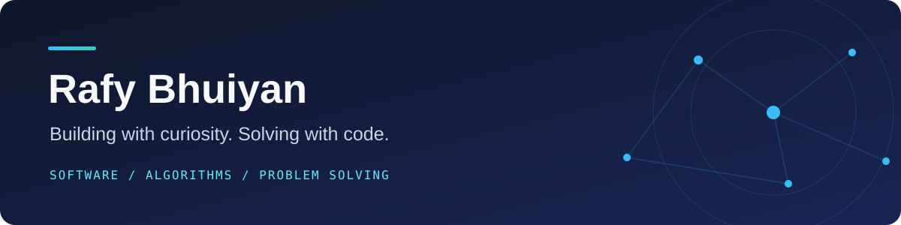
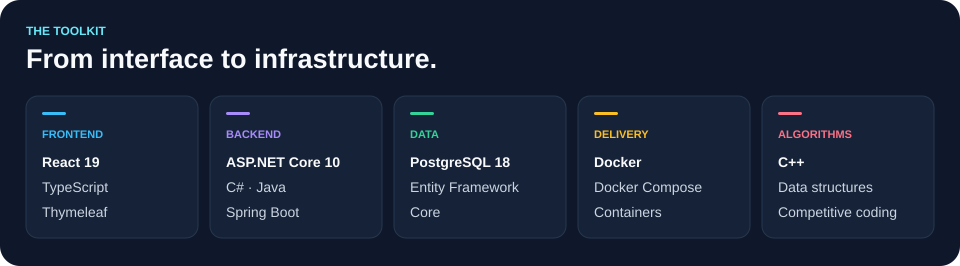

  

<h1 align="center">Hi, I'm Rafy 👋</h1>

<strong>Aspiring software developer · Competitive programmer · Dhaka, Bangladesh</strong>

  

  
  
  
  

## Stacks I've worked with

Stack details

| Area | Technologies |
| --- | --- |
| Frontend | React , Thymeleaf, HTML, CSS |
| Backend | ASP.NET Core 10, Spring Boot, Laravel, NodeJS |
| Data | Entity Framework Core, PostgreSQL 18 |
| Containers | Docker, Docker Compose |
| Problem solving | C++, data structures and algorithms |

## My language lion 🦁

  

Language shares are calculated from **code bytes in my public, non-fork repositories**, not working hours or skill levels. Organization-owned projects such as PlanR are outside this chart. The colored areas of the mane represent those shares, with a matching legend. The lion holds an alert, snarling pose with breathing motion, blinking eyes, and a flicking tail. Refreshed daily by GitHub Actions; small shares may round to less than 0.1%.

## Problem solving

**Core interests:** Data structures · Algorithms · Competitive programming

I use contest problems to practice choosing the right data structure, reasoning about edge cases, and analyzing time and space complexity. Follow my contest activity on [Codeforces](https://codeforces.com/profile/Rafy55).

## GitHub activity

[View my contribution calendar on GitHub →](https://github.com/RafyBhuiyan?tab=overview)

These cards refresh daily with GitHub Actions. Contributions cover the last 365 days; indexed authored commits cover 30 days. Push counts use the available public event feed, capped by GitHub at 300 events, so they can be incomplete. Commit counts and calendar contributions are different measures.

[Browse my commits](https://github.com/search?q=author%3ARafyBhuiyan&type=commits) · [View public activity](https://github.com/RafyBhuiyan?tab=overview)

---

