  

<h1 align="center">Hi, I'm Rafy 👋</h1>

<strong>Aspiring software developer · Competitive programmer · Dhaka, Bangladesh</strong>

  

  
  
  
  

## A little about me

I enjoy breaking complex problems into clear, practical solutions. Competitive programming is where I practice algorithmic thinking; software projects are where I explore how that thinking translates into useful tools.

- **Recently built:** a [School Admission System](https://github.com/RafyBhuiyan/School-Admission-System) with timed seat reservations and a protected administration panel.
- **Deepening my foundations:** graphs, trees, dynamic programming, and complexity analysis.
- **Open to:** internships, collaboration, and code reviews.
- **Let's talk:** [rafybhuiyan23@gmail.com](mailto:rafybhuiyan23@gmail.com).

## Selected work

### 🎓 [School Admission System](https://github.com/RafyBhuiyan/School-Admission-System)

A school admission portal where students reserve a seat, confirm it before the timer ends, and return later to view their applications. Administrators create admission classes and review applications from a protected panel.

**Stack:** React 19 · TypeScript · ASP.NET Core 10 · EF Core · PostgreSQL 18 · Docker Compose

[Quick start](https://github.com/RafyBhuiyan/School-Admission-System#quick-start) · [Using the portal](https://github.com/RafyBhuiyan/School-Admission-System#using-the-portal) · [How it works](https://github.com/RafyBhuiyan/School-Admission-System#how-it-works) · [Development](https://github.com/RafyBhuiyan/School-Admission-System#development) · [Tests](https://github.com/RafyBhuiyan/School-Admission-System#tests) · [Documentation](https://github.com/RafyBhuiyan/School-Admission-System#documentation)

### 🗓️ [PlanR](https://github.com/DSi-Internship-Syntax50/PlanR)

An academic resource, scheduling, and facility management platform. It brings room allocation, conflict detection, routine generation, and exam seat planning into one place.

**Project stack:** Java · Spring Boot · PostgreSQL · Thymeleaf · Docker

[Explore the code →](https://github.com/DSi-Internship-Syntax50/PlanR)

### 🧩 [Templates](https://github.com/RafyBhuiyan/Templates)

My C++ templates repository, alongside my focus on competitive programming and algorithmic problem solving.

**Language:** C++

[Explore the code →](https://github.com/RafyBhuiyan/Templates) · [View my Codeforces profile →](https://codeforces.com/profile/Rafy55)

## Stacks I've worked with

| Area | Technologies |
| --- | --- |
| Frontend | React 19, TypeScript, Thymeleaf |
| Backend | ASP.NET Core 10, C#, Java, Spring Boot |
| Data | Entity Framework Core, PostgreSQL 18 |
| Containers | Docker, Docker Compose |
| Problem solving | C++, data structures and algorithms |

## My language companions 🐈

  

Language shares are calculated from **code bytes in my public, non-fork repositories**, not working hours or skill levels. Organization-owned projects such as PlanR are outside this chart. Updated daily with GitHub Actions; small shares may round to less than 0.1%.

## Problem solving

**Core interests:** Data structures · Algorithms · Competitive programming

I use contest problems to practice choosing the right data structure, reasoning about edge cases, and analyzing time and space complexity. Follow my contest activity on [Codeforces](https://codeforces.com/profile/Rafy55).

## GitHub activity

  

  
More GitHub stats

   
  

    
  

<!-- Dynamic images are hosted by third-party services and may be cached or temporarily unavailable. -->

---

  <strong>Have an internship opportunity or a project in mind?</strong> 
  <a href="mailto:rafybhuiyan23@gmail.com">Let's connect</a> · <a href="https://my-portfolio-pi-ecru-92.vercel.app/">View my portfolio</a> · <a href="https://www.linkedin.com/in/rafy-bhuiyan-870a85281">LinkedIn</a>

